<div align="center">

<a href="https://legendacr.github.io/size-of-space/">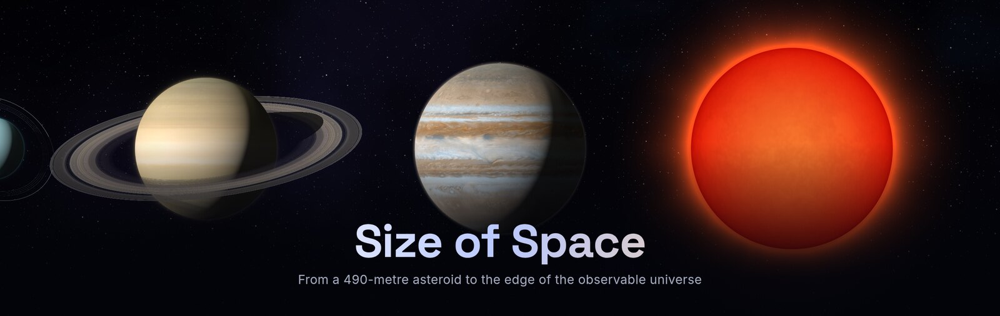</a>

<br />
<br />

**An interactive journey through 79 cosmic objects and 24 orders of magnitude,<br />rendered in real time in your browser.**

<br />

<a href="https://legendacr.github.io/size-of-space/"></a>

<br />
<br />

[](LICENSE)
[](https://threejs.org)
[](https://www.typescriptlang.org)
[](https://vite.dev)
[](https://github.com/LegendaCR/size-of-space/stargazers)

[English](README.md) · [Русский](README.ru.md)

</div>

<br />

##  What is this?

**Size of Space** shows how big things in the universe really are, one step at a time.
Each object sits next to the one before it, so you always see its size against something you just saw.
Scroll on and the camera keeps zooming out: asteroids give way to moons, planets, stars, black holes, nebulae and galaxies, and finally the whole observable universe, while the soundtrack swells with the scale.

Inspired by [neal.fun/size-of-life](https://neal.fun/size-of-life/), but for the cosmos.

<div align="center">
<a href="https://legendacr.github.io/size-of-space/#moon">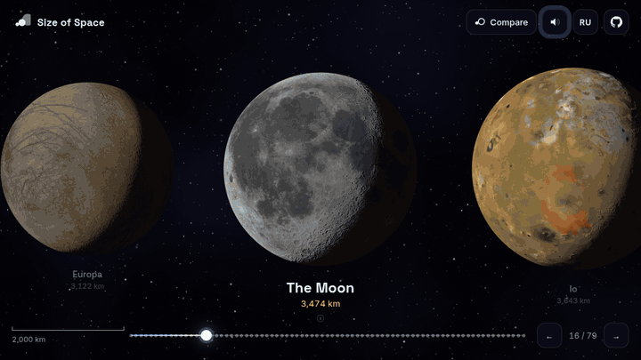</a>
<p><sub><b>THE JOURNEY</b> · from the Moon, past the planets and the Sun, to the giant stars</sub></p>
</div>

<table>
  <tr>
    <td width="50%"><a href="https://legendacr.github.io/size-of-space/#compare=earth,sun">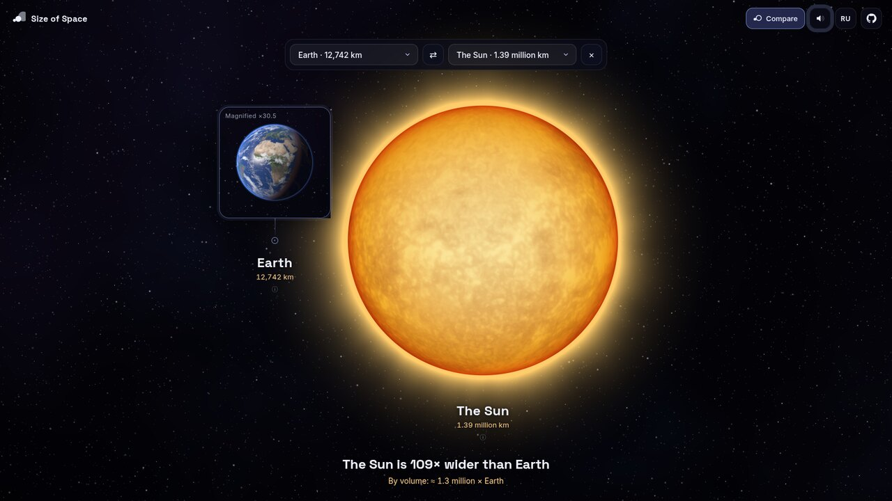</a></td>
    <td width="50%"><a href="https://legendacr.github.io/size-of-space/#compare=sun,milkyway">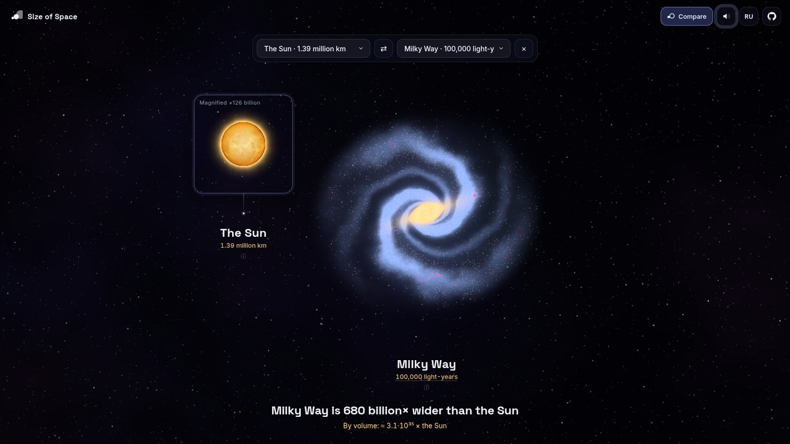</a></td>
  </tr>
  <tr>
    <td align="center"><sub><b>COMPARE MODE</b> · Earth next to the Sun at true scale</sub></td>
    <td align="center"><sub><b>COMPARE MODE</b> · the Sun shrinks to a point next to the Milky Way</sub></td>
  </tr>
</table>

<table>
  <tr>
    <td width="50%"><a href="https://legendacr.github.io/size-of-space/#earth">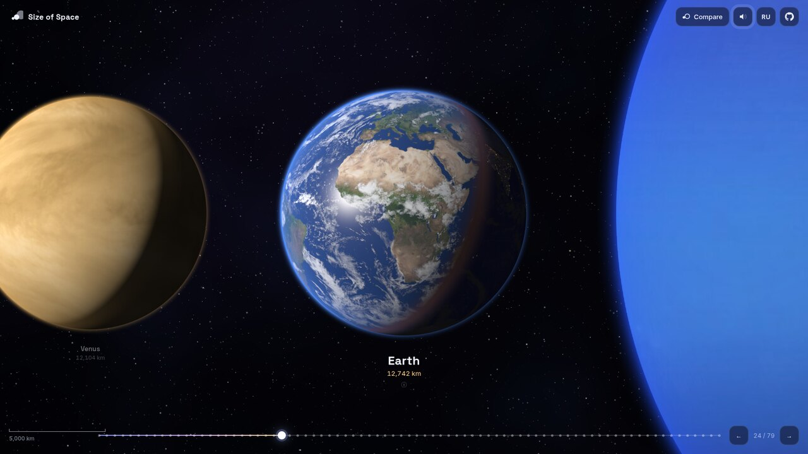</a></td>
    <td width="50%"><a href="https://legendacr.github.io/size-of-space/#saturn">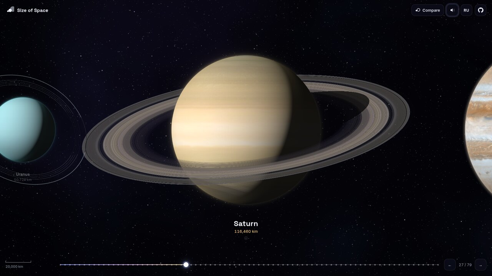</a></td>
  </tr>
  <tr>
    <td align="center"><sub><b>EARTH</b> · clouds with shadows, ocean glint and city lights</sub></td>
    <td align="center"><sub><b>SATURN</b> · ray-traced rings that cast shadows</sub></td>
  </tr>
  <tr>
    <td width="50%"><a href="https://legendacr.github.io/size-of-space/#moon">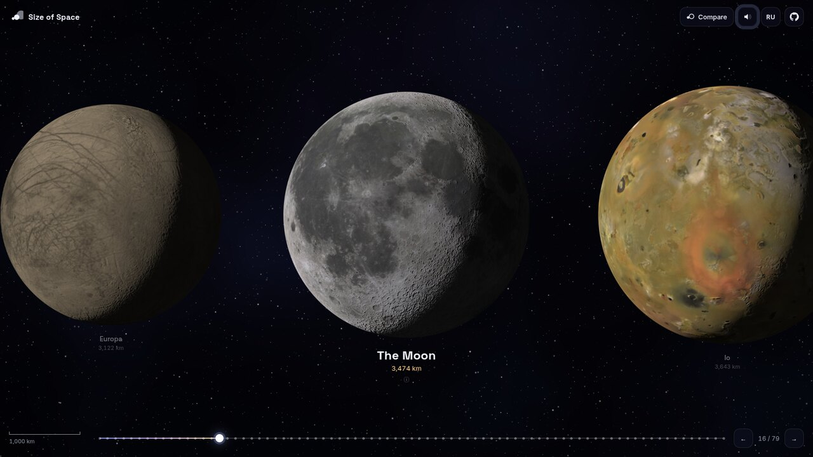</a></td>
    <td width="50%"><a href="https://legendacr.github.io/size-of-space/#sgra">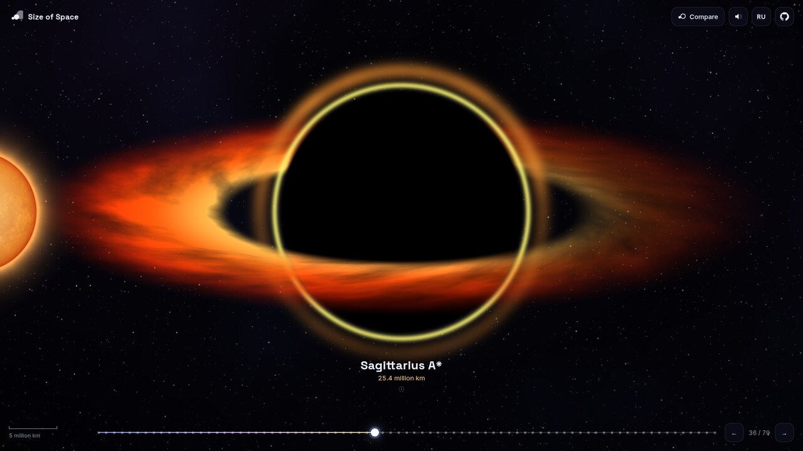</a></td>
  </tr>
  <tr>
    <td align="center"><sub><b>THE MOON</b> · real lunar maps with regolith lighting</sub></td>
    <td align="center"><sub><b>SAGITTARIUS A*</b> · an accretion disk with Doppler beaming</sub></td>
  </tr>
  <tr>
    <td width="50%"><a href="https://legendacr.github.io/size-of-space/#pillars">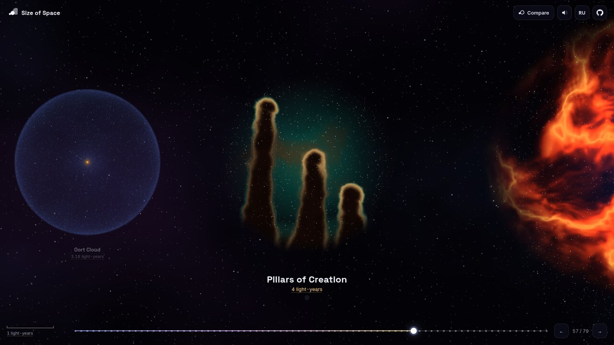</a></td>
    <td width="50%"><a href="https://legendacr.github.io/size-of-space/#milkyway">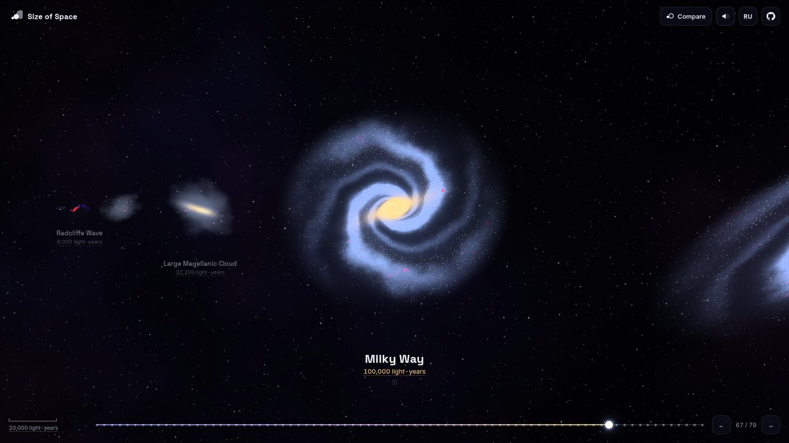</a></td>
  </tr>
  <tr>
    <td align="center"><sub><b>PILLARS OF CREATION</b> · a stellar nursery</sub></td>
    <td align="center"><sub><b>MILKY WAY</b> · our home among 100+ billion stars</sub></td>
  </tr>
  <tr>
    <td width="50%"><a href="https://legendacr.github.io/size-of-space/#betelgeuse">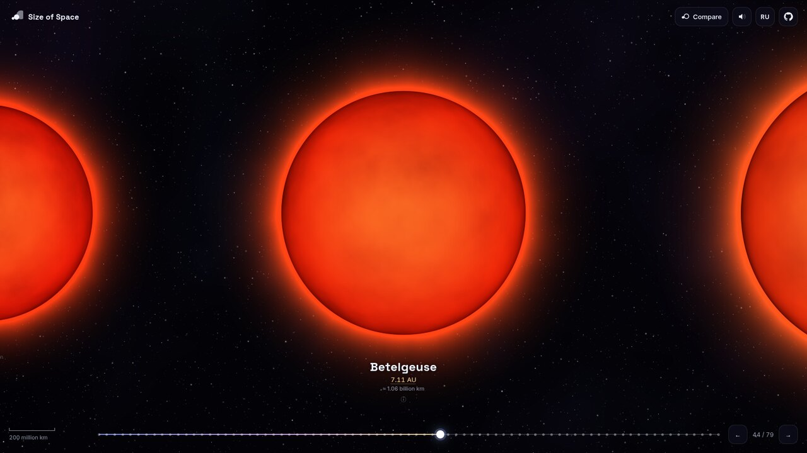</a></td>
    <td width="50%" valign="middle">
      <b>BETELGEUSE</b> · a red supergiant 764 times wider than the Sun.<br /><br />
      <sub>Unfamiliar units explain themselves: sizes in astronomical units come with a kilometre conversion, and hovering <code>AU</code> or <code>light-years</code> shows what the unit means.</sub>
    </td>
  </tr>
</table>

##  Features

- **79 objects, 24 orders of magnitude**: from asteroid Bennu (490 m) to the observable universe (93 billion light-years).
- **Real surfaces.** Planets and moons use actual spacecraft maps (NASA, JPL, USGS, Solar System Scope) on 3D spheres with relief, atmospheres and physically based lighting.
- **Ray-traced and ray-marched details**: Saturn's rings cast shadows on the planet and the planet on its rings; asteroids and comets are true 3D bodies with self-shadowing.
- **Procedural deep space**: stars, black holes, nebulae, galaxies and the cosmic web are generated by custom GLSL shaders, so they are alive and never pixelate.
- **Compare mode**: pick any two objects, from a 490-metre asteroid to the whole universe, and see them side by side at true scale, with diameter and volume ratios. When one is too small to see, it collapses to a point and a magnifier shows it up close. Every comparison has its own link, e.g. [`#compare=earth,sun`](https://legendacr.github.io/size-of-space/#compare=earth,sun).
- **Units explained**: astronomical units come with a kilometre conversion, and hovering a unit shows what it means.
- **A soundtrack that grows with scale**: generative music built with the Web Audio API. It starts as a quiet pad and gains a sub-bass, arpeggios, a choir, strings, timpani and bells as you travel outward.
- **Real data**: diameters, distances and facts for every object, with links to Wikipedia.
- **Smooth navigation** with the wheel, trackpad, swipes, keyboard or timeline. Every object has its own shareable URL, e.g. [`#betelgeuse`](https://legendacr.github.io/size-of-space/#betelgeuse).
- **English and Russian**, picked automatically from your browser.
- **Light**: a static site with one runtime dependency (three.js) that works offline once cloned.

##  The journey

| Scale | Objects |
| --- | --- |
| **Small bodies** | Bennu · Ryugu · Comet 67P · Halley's Comet · Deimos · a neutron star · Phobos · Mathilde · Hyperion |
| **Moons and dwarf planets** | Enceladus · Vesta · Ceres · Charon · Pluto · Europa · the Moon · Io · Titan · Ganymede |
| **Planets** | Mercury · Mars · Venus · Earth · Neptune · Uranus · Saturn · Jupiter |
| **Stars** | Sirius B · TRAPPIST-1 · Proxima Centauri · the Sun · Sirius · Vega · Pollux · Arcturus · Aldebaran · Rigel · Deneb · Antares · Betelgeuse · UY Scuti · VY Canis Majoris · Stephenson 2-18 |
| **Black holes** | Sagittarius A* · M87* · TON 618 |
| **Orbits and the Solar System** | Orbit of the Moon · Mercury · Earth · Jupiter · the Solar System · Heliosphere · Oort Cloud |
| **Nebulae and clusters** | Cat's Eye · Barnard 68 · Ring Nebula · Pillars of Creation · Crab · Orion · Eagle · Omega Centauri · Tarantula |
| **Galaxies** | Gould Belt · Radcliffe Wave · Magellanic Clouds · Milky Way · Andromeda · Malin 1 · IC 1101 · Alcyoneus |
| **Largest structures** | Local Group · Virgo Cluster · Virgo Supercluster · Boötes Void · Laniakea · Sloan Great Wall · Hercules–Corona Borealis Great Wall · **the Observable Universe** |

##  Controls

| Action | Mouse / trackpad | Keyboard | Touch |
| --- | --- | --- | --- |
| Travel | Scroll or drag | `←` `→` / `Space` | Swipe |
| Object details | Click the object | `Enter` / `I` | Tap |
| Jump to the start or end | Timeline | `Home` / `End` | Timeline |
| Compare two objects | **Compare** button | `Esc` to leave | **Compare** button |
| Music on/off | Speaker button | | Speaker button |

The music starts with your first click or key press, because browsers don't allow autoplay.

##  Run it locally

```bash
git clone https://github.com/LegendaCR/size-of-space.git
cd size-of-space
npm install
npm run dev
```

Then open http://localhost:5173. Run `npm run build` to make a production build in `dist/`, which you can host on any static server.

##  Add your own object

Every object is one entry in [`src/data/objects.ts`](src/data/objects.ts):

```ts
{
  id: 'mars', d: 6779 * KM, kind: 'textured', cat: 'planet', dist: 1.5 * AU, wiki: 'Mars',
  look: { c: ['#ffffff', '#e8a878', '#ffffff'], p: [0.8, 0.4, 0.5, 0], tex: ['mars'] },
  name: { en: 'Mars', ru: 'Марс' },
  fact: { en: '…', ru: '…' },
}
```

Pick a `kind` (`textured`, `asteroid`, `star`, `blackhole`, `nebula`, `galaxy`, `web`, …), drop a map into `public/textures/` if you have one, and insert the entry in size order. See [CONTRIBUTING.md](CONTRIBUTING.md) for details.

##  How it works

```
src/
├── data/objects.ts      # the catalogue: sizes, distances, facts, visual parameters
├── render/scene.ts      # layout, camera (log-space zoom) and texture streaming
├── render/realistic.ts  # textured planets, ray-traced rings, ray-marched asteroids, stars
├── render/shaders.ts    # procedural shaders for nebulae, galaxies, black holes, cosmic web
├── audio.ts             # generative soundtrack
├── main.ts              # input, labels, timeline, info panel
└── i18n.ts · format.ts  # translations and unit formatting
```

Objects are placed side by side in real metres. The camera zooms between neighbours in **logarithmic space**, so every step feels the same, whether you go from 490 m to 900 m or from 10 to 93 billion light-years. Positions are computed in 64-bit numbers relative to the camera and handed to the GPU in screen pixels, which avoids floating-point problems across 24 orders of magnitude.

##  A note on accuracy

Sizes come from published values, mostly via Wikipedia and NASA. Some are uncertain (the largest stars, IC 1101, the Hercules–Corona Borealis Great Wall), and estimates for them vary widely. Black holes are sized by their event horizon. Planet and moon surfaces are real maps; deep-space objects are artistic procedural interpretations.

##  Credits

- Planet, Sun and Moon textures: [Solar System Scope](https://www.solarsystemscope.com/textures/), licensed under [CC BY 4.0](https://creativecommons.org/licenses/by/4.0/).
- Maps of Pluto, Charon, Europa, Io, Enceladus and Vesta: NASA / JPL / USGS (New Horizons, Galileo, Voyager, Cassini and Dawn missions), public domain, via Wikimedia Commons.
- Rendering by [three.js](https://threejs.org). Inspired by Neal Agarwal's [Size of Life](https://neal.fun/size-of-life/); this project is not affiliated with neal.fun.

##  Contributing

Contributions are welcome: new objects, better shaders, translations or fixes for the facts. See [CONTRIBUTING.md](CONTRIBUTING.md).

<div align="center">
<br />

<br />
<b>If you enjoyed the trip, a star helps other people find it.</b>
<br />
<br />
<sub><a href="LICENSE">MIT License</a> © LegendaCR</sub>
</div>
