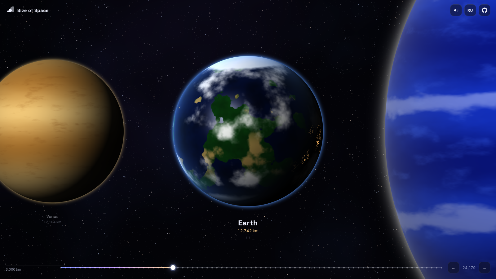
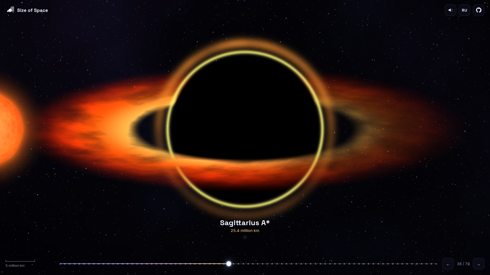
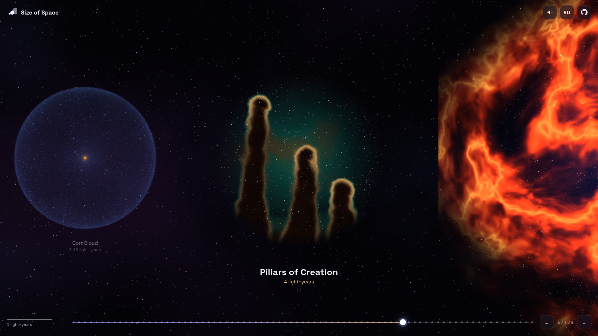
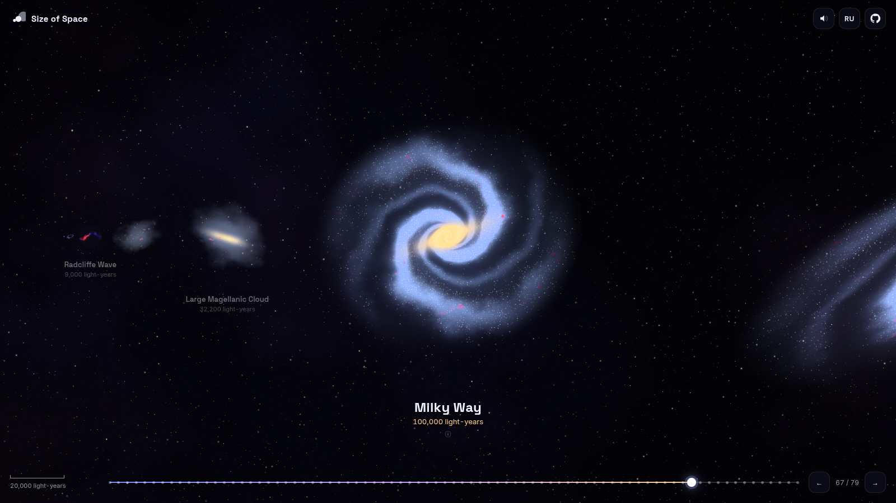

<div align="center">

# 🪐 Size of Space

### Scroll from a 490-metre asteroid to the edge of the observable universe.

**An interactive, procedurally rendered journey through 79 cosmic objects and 24 orders of magnitude.**

[**▶ Launch the live demo**](https://legendacr.github.io/size-of-space/)

[](https://legendacr.github.io/size-of-space/)
[](LICENSE)
[](https://threejs.org)
[](https://www.typescriptlang.org)

[English](README.md) · [Русский](README.ru.md)

<br />

<a href="https://legendacr.github.io/size-of-space/#saturn"></a>

</div>

---

## ✨ What is this?

**Size of Space** shows how big things in the universe really are, one step at a time.
Each object sits next to the one before it, so you always see its size against something you just saw.
Scroll on and the camera keeps zooming out: asteroids give way to moons, planets, stars, black holes, nebulae and galaxies, and finally the whole observable universe.

Inspired by [neal.fun/size-of-life](https://neal.fun/size-of-life/), but for the cosmos.

<table>
  <tr>
    <td width="50%"><a href="https://legendacr.github.io/size-of-space/#earth"></a></td>
    <td width="50%"><a href="https://legendacr.github.io/size-of-space/#sgra"></a></td>
  </tr>
  <tr>
    <td align="center"><b>Earth</b>: oceans, clouds and city lights on the night side</td>
    <td align="center"><b>Sagittarius A*</b>: an accretion disk with Doppler beaming</td>
  </tr>
  <tr>
    <td width="50%"><a href="https://legendacr.github.io/size-of-space/#pillars"></a></td>
    <td width="50%"><a href="https://legendacr.github.io/size-of-space/#milkyway"></a></td>
  </tr>
  <tr>
    <td align="center"><b>Pillars of Creation</b>: a stellar nursery</td>
    <td align="center"><b>Milky Way</b>: our home among 100+ billion stars</td>
  </tr>
</table>

## 🚀 Features

- **79 objects, 24 orders of magnitude**: from asteroid Bennu (490 m) to the observable universe (93 billion light-years).
- **No images at all.** Every planet, star, nebula and galaxy is drawn in real time by custom GLSL shaders: rotating planets, boiling stellar surfaces, swirling accretion disks and a live cosmic web.
- **Real data.** Diameters, distances and facts for each object, with links to Wikipedia.
- **Smooth navigation** with the mouse wheel, trackpad, touch swipes, keyboard or the timeline. Every object has its own shareable URL, e.g. [`#betelgeuse`](https://legendacr.github.io/size-of-space/#betelgeuse).
- **Generative ambient soundtrack** built with the Web Audio API. Its pitch drops as you travel further out.
- **English & Russian**, picked automatically from your browser language.
- **Fast and tiny**: a static site with a single dependency (three.js). It works offline after you clone it.

## 🔭 The journey

| Scale | Objects |
| --- | --- |
| **Small bodies** | Bennu · Ryugu · Comet 67P · Halley's Comet · Deimos · a neutron star · Phobos · Mathilde · Hyperion |
| **Moons & dwarf planets** | Enceladus · Vesta · Ceres · Charon · Pluto · Europa · the Moon · Io · Titan · Ganymede |
| **Planets** | Mercury · Mars · Venus · Earth · Neptune · Uranus · Saturn · Jupiter |
| **Stars** | Sirius B · TRAPPIST-1 · Proxima Centauri · the Sun · Sirius · Vega · Pollux · Arcturus · Aldebaran · Rigel · Deneb · Antares · Betelgeuse · UY Scuti · VY Canis Majoris · Stephenson 2-18 |
| **Black holes** | Sagittarius A* · M87* · TON 618 |
| **Orbits & the Solar System** | Orbit of the Moon · Mercury · Earth · Jupiter · the Solar System · Heliosphere · Oort Cloud |
| **Nebulae & clusters** | Cat's Eye · Barnard 68 · Ring Nebula · Pillars of Creation · Crab · Orion · Eagle · Omega Centauri · Tarantula |
| **Galaxies** | Gould Belt · Radcliffe Wave · Magellanic Clouds · Milky Way · Andromeda · Malin 1 · IC 1101 · Alcyoneus |
| **Largest structures** | Local Group · Virgo Cluster · Virgo Supercluster · Boötes Void · Laniakea · Sloan Great Wall · Hercules–Corona Borealis Great Wall · **the Observable Universe** |

## 🎮 Controls

| Action | Mouse / trackpad | Keyboard | Touch |
| --- | --- | --- | --- |
| Travel | Scroll or drag | `←` `→` / `Space` | Swipe |
| Object details | Click the object | `Enter` / `I` | Tap |
| Jump to the start or end | Timeline | `Home` / `End` | Timeline |
| Close the panel | Click empty space | `Esc` | Tap outside |

## 🛠 Run it locally

```bash
git clone https://github.com/LegendaCR/size-of-space.git
cd size-of-space
npm install
npm run dev
```

Then open http://localhost:5173. To make a production build, run `npm run build`; the output goes to `dist/` and can be hosted on any static server.

## ➕ Add your own object

Every object is a single entry in [`src/data/objects.ts`](src/data/objects.ts):

```ts
{
  id: 'mars', d: 6779 * KM, kind: 'rocky', cat: 'planet', dist: 1.5 * AU, wiki: 'Mars',
  look: { c: ['#7a3420', '#c1643a', '#e0a070', '#ffffff'], p: [0.25, 1.6, 1, 0] },
  name: { en: 'Mars', ru: 'Марс' },
  fact: { en: '…', ru: '…' },
}
```

Pick a `kind` (`rocky`, `gas`, `star`, `blackhole`, `nebula`, `galaxy`, `web`, …), set a colour palette, insert it in size order, and you're done. The shaders for every kind live in [`src/render/shaders.ts`](src/render/shaders.ts).

## 🧱 How it works

```
src/
├── data/objects.ts     # the catalogue: sizes, distances, facts, visual parameters
├── render/scene.ts     # layout & camera: interpolates zoom in log space
├── render/shaders.ts   # one procedural fragment shader per object kind
├── main.ts             # input, labels, timeline, info panel
├── audio.ts            # generative ambient drone
└── i18n.ts / format.ts # translations and unit formatting
```

Objects are placed side by side in real metres. The camera zooms between neighbours in **logarithmic space**, so every step feels the same whether you go from 490 m to 900 m or from 10 to 93 billion light-years. Positions are computed in 64-bit JavaScript numbers relative to the camera and handed to the GPU in screen pixels, which avoids floating-point problems across 24 orders of magnitude.

## 📏 A note on accuracy

Sizes come from published values, mostly via Wikipedia and NASA. Some are hard to measure (the largest stars, IC 1101, the Hercules–Corona Borealis Great Wall), and estimates for them vary widely; the info panel notes this. Black holes are sized by their event horizon. The visuals are artistic, procedural interpretations, not photographs.

## 🤝 Contributing

Contributions are welcome: new objects, better shaders, translations or fixes for the facts. See [CONTRIBUTING.md](CONTRIBUTING.md).

If you enjoyed the trip, **consider giving the repo a ⭐**. It helps other people find it.

## 📄 License

[MIT](LICENSE) © LegendaCR. Inspired by Neal Agarwal's [Size of Life](https://neal.fun/size-of-life/); this project is not affiliated with neal.fun.
