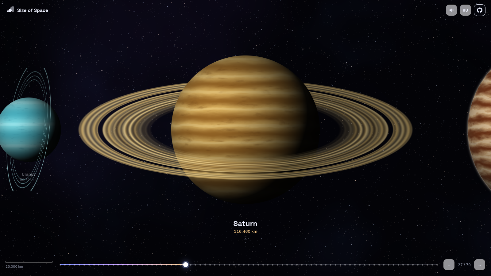

<div align="center">

# 🪐 Size of Space: размеры космоса

### Пролистайте путь от 490-метрового астероида до границы наблюдаемой Вселенной.

**Интерактивное путешествие по 79 космическим объектам и 24 порядкам величины. Все объекты рисуются процедурно.**

[**▶ Открыть демо**](https://legendacr.github.io/size-of-space/?lang=ru)

[English](README.md) · [Русский](README.ru.md)

<br />

<a href="https://legendacr.github.io/size-of-space/?lang=ru#saturn"></a>

</div>

---

## ✨ Что это?

**Size of Space** наглядно показывает, насколько велики объекты во Вселенной. Каждый объект стоит рядом с предыдущим, так что его размер всегда видно в сравнении с тем, что вы только что видели. Камера постепенно отдаляется: астероиды сменяются спутниками, затем идут планеты, звёзды, чёрные дыры, туманности, галактики и, наконец, вся наблюдаемая Вселенная.

Проект вдохновлён [neal.fun/size-of-life](https://neal.fun/size-of-life/), только про космос.

## 🚀 Возможности

- **79 объектов, 24 порядка величины**: от астероида Бенну (490 м) до наблюдаемой Вселенной (93 млрд световых лет).
- **Ни одной картинки.** Каждая планета, звезда, туманность и галактика рисуется в реальном времени шейдерами GLSL: планеты вращаются, поверхность звёзд «кипит», аккреционные диски закручиваются, а космическая паутина живёт.
- **Реальные данные**: диаметры, расстояния и интересные факты о каждом объекте со ссылками на Википедию.
- **Плавная навигация** колесом мыши, тачпадом, свайпами, клавиатурой или по шкале. У каждого объекта своя ссылка, например [`#betelgeuse`](https://legendacr.github.io/size-of-space/?lang=ru#betelgeuse).
- **Генеративный эмбиент** на Web Audio API: чем дальше вы улетаете, тем ниже и глубже звук.
- **Русский и английский языки**, выбираются автоматически по языку браузера.
- **Лёгкий статический сайт** с одной зависимостью (three.js). После клонирования работает без интернета.

## 🎮 Управление

| Действие | Мышь / тачпад | Клавиатура | Сенсор |
| --- | --- | --- | --- |
| Лететь дальше / назад | Прокрутка или перетаскивание | `←` `→` / `Пробел` | Свайп |
| Подробности | Клик по объекту | `Enter` / `I` | Тап |
| В начало / в конец | Шкала внизу | `Home` / `End` | Шкала |

## 🛠 Запуск локально

```bash
git clone https://github.com/LegendaCR/size-of-space.git
cd size-of-space
npm install
npm run dev
```

Затем откройте http://localhost:5173. Для продакшен-сборки выполните `npm run build`, готовый сайт появится в папке `dist/`.

## ➕ Как добавить объект

Все объекты описаны в [`src/data/objects.ts`](src/data/objects.ts). Добавьте запись с размером, типом отрисовки (`kind`), палитрой и текстами на двух языках и поставьте её в список по порядку размера. Подробнее см. [CONTRIBUTING.md](CONTRIBUTING.md).

## 📄 Лицензия

[MIT](LICENSE) © LegendaCR. Если проект понравился, **поставьте ⭐**: так его найдут другие.
